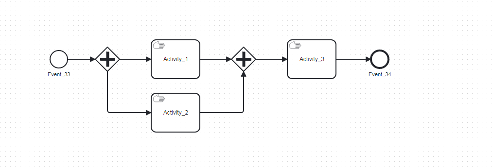

# BPMN

（Business Process Model and Notation）是业务流程模型和表示法的缩写，它是一种用于业务流程建模和管理的标准符号集。BPMN 提供了一种图形化的方式来表示业务流程，更容易地理解和交流业务流程。

如下图：



# 使用步骤

## 0、生成bpmn

可在 在线生成网站生成对应的bpmn：如：http://bpmn\.majh\.top/

注意理解各种图标的不同含义

如上图：

```Python
1、圆圈  --> 启动、关闭
2、十字图标  --> 并行网关、即他所有指向的分支都需要执行，所有指向他的分支得执行结束后，他才会执行
3、手工任务  --> spiffworkflow默认手动任务manual为true，执行到至此处会等待执行
```

## 1、实例化bpmn文件为workflow

```Python
def get_parser(file_path, validate=True):
    validator = BpmnValidator() if validate else None
    parser = TestBpmnParser(validator=validator)
    parser.add_bpmn_files_by_glob(file_path))
    return parser

def load_workflow_spec(cls, parser, process_name):
    """
    加载工作流
    """  
    top_level_spec = parser.get_spec(process_name)
    subprocesses = parser.get_subprocess_specs(process_name)
    return top_level_spec, subprocesses

_parser = get_parser(file_path)
spec, subprocesses = BpmnWorkflowHelper.load_workflow_spec(_parser, process_name)
BpmnWorkflow(spec, subprocesses)
```

## 2、设置流程等待步骤（手工处理）

workflow的执行是自动的进行，而有的时候，我们需要workflow在某些执行某些步骤前停下，这时需要将该步骤的 manual 属性设置为 true 。

```Python
# 在get_parser() 中使用

from SpiffWorkflow.bpmn.parser import event_parsers
from SpiffWorkflow.bpmn.parser.BpmnParser import BpmnParser
from SpiffWorkflow.bpmn.specs import defaults

class TestBpmnParser(BpmnParser):
    # 将 开始 、结束 设置为手工处理
    # 手工事件默认继承 defaults.ManualTask
    OVERRIDE_PARSER_CLASSES = {
        full_tag('startEvent'): (event_parsers.StartEventParser, defaults.ManualTask),
        full_tag('endEvent'): (event_parsers.EndEventParser, defaults.ManualTask),
    }

# 在defaults.ManualTask中，设置: manual=True
```

# 3、workflow 可以序列化、反序列化为各种数据结构

```Python
# 将dict序列化为workflow
BpmnWorkflowHelper().serializer.workflow_from_dict(_dict)

# 将workflow反序列化为dict
BpmnWorkflowHelper().serializer.workflow_to_dict(workflow)

# 将workflow序列化为json
BpmnWorkflowHelper().serializer.serialize_json(workflow)

# 将json反序列化为workflow
BpmnWorkflowHelper().serializer.deserialize_json(workflow_json)
```

## 4、执行workflow

Workflow 下每个步骤都具有各自的状态定义

```Python
关键状态：
READY  # 可执行
WAITING  # 等待结束
STARTED  # 已启动
COMPLETED  # 已完成
```


workflow的执行是自动的，他会根据设置的流程步骤进行执行

```Python
workflow.do_engine_steps()  # 内部循环的执行所有已经 ready 的步骤
```

修改某个步骤的状态

```Python
# 找到任务
# 特殊定义：同一流程下 仅有 task_spec_id 唯一，既一个流程中 同一步骤只能有一个。
task = workflow.get_tasks_from_spec_name(f"Activity_{self.task_obj.task_spec_id}")[0]
# 设置状态
task._set_state(TaskState.STARTED)  
```

执行结束某一个步骤，并自动推进后续步骤

```Python
# 内部封装了一个方法：
workflow_helper.BpmnWorkflowHelper.do_next_named_step(workflow, step_name, with_save_load=True)
```


