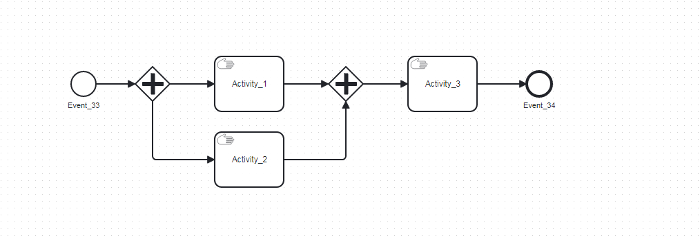

# 已知问题记录

# 一、environmentBrowser\.QueryConfigOption

## 版本：\<=pyvmomi 8\.0\.3\.0\.1 

## 作用：查询 **配置选项与操作系统描述符**

## 问题：vsphere 7\.0\.x 版本 在获取相关信息是报错：

TypeError: VirtualQAT



## 现有资料：

官方暂未解决该问题：https://github\.com/vmware/pyvmomi/issues/915

## 绕过方法：

```Python
from pyVmomi.VmomiSupport import CreateDataType
CreateDataType("vim.vm.device.VirtualQAT", "VirtualQAT",
               "vim.vm.device.VirtualDevice", "vim.version.v7_0", None)
CreateDataType("vim.vm.device.VirtualQAT.DeviceBackingInfo", "VirtualQATDeviceBackingInfo",
               "vim.vm.device.VirtualDevice.DeviceBackingInfo", "vim.version.v7_0", None)
CreateDataType("vim.vm.device.VirtualQATOption", "VirtualQATOption",
               "vim.vm.device.VirtualDeviceOption", "vim.version.v7_0", None)
CreateDataType("vim.vm.device.VirtualQATOption.DeviceBackingOption", "VirtualQATDeviceBackingOption",
               "vim.vm.device.VirtualDeviceOption.DeviceBackingOption", "vim.version.v7_0", None)
```

## 解释: 将无法解析的类型手动注册相关映射。


